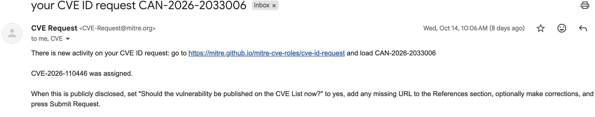
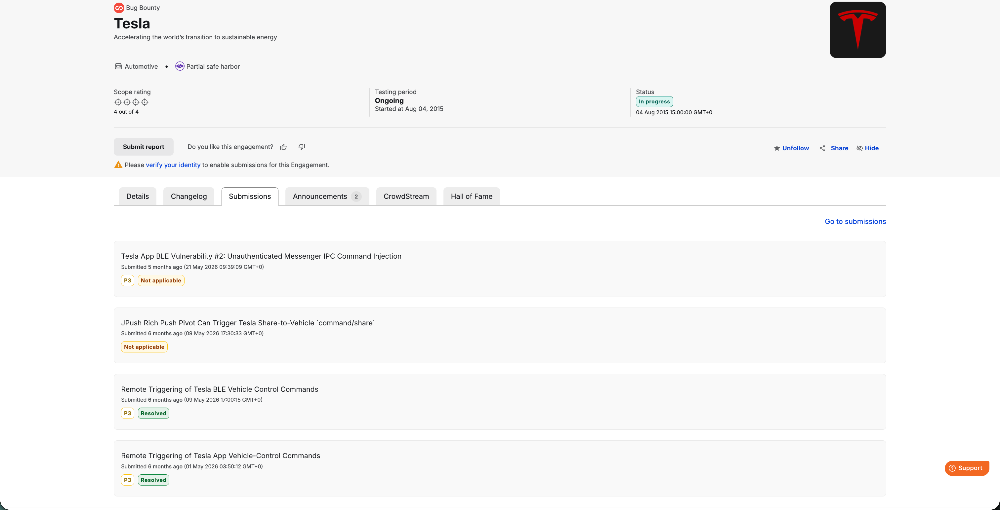
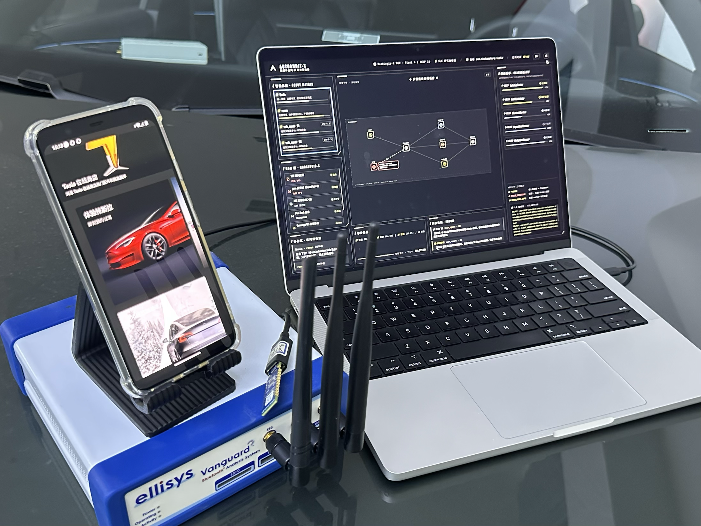

# AutoAudit-X：软硬件协同的 AI 智能体——从 Tesla 数字钥匙到物理车辆的完整攻击链

**[English](README.md) | [中文](README-zh.md)**

> Black Hat Asia 2026 Briefings 白皮书
> 议题方向：Application Security: Offense; AI & ML: Attack and Defense

---

## 摘要

你的手机上装着 Tesla App，你的车就停在外面——一个 AI 智能体驱动的攻击链，让你手机上任意一个 App 都可以打开并解锁你的车辆。

本文披露 Tesla App 数字钥匙生态中的三个新漏洞。其中一个覆盖**全车系**，让一个什么权限都没申请的应用可以直接控制车辆——车主全程无感（CVE-2026-110446，Tesla 已认可并修复，Bugcrowd 赏金 1,500 美元）。另一个漏洞能无感改写车机导航目的地，厂商以"预期设计"为由拒绝修复——我们公开完整攻击链与实车录像，交由社区独立评判。第三个漏洞被厂商认定与既有外部报告重复，未单独分配编号。此外，本方法在多家头部车企共产出 **3 个 CVE 与 22 个中国 CAPPVD 编号**。

支撑这一切的是 **AutoAudit-X (AX)**——首个软硬件结合的 AI Agent 团队：Agent 团队负责推理与对抗复核（侦察、审计、异构模型交叉验证压制漏报）；系统与硬件底座负责观测（把 Root 隐藏、脱壳、方法级 Hook、TLS 密钥导出直接编译进 Android 系统，双轨 BLE 研究台把攻击面从 App 层延伸到物理车辆）。当最强公开 AI Agent 对着加固后的车企 App 束手无策时，AutoAudit-X 把整个攻击链跑到了车端。

**核心论断：AI 安全的下一步，不止是优化 Agent，更是为 Agent 重建系统与硬件级的观测底座。**

---

## 1. 引言：让 AI 失效的车联网目标

### 1.1 一个对人与 AI 都过难的问题

车联网的攻击面分布在三个异构层面：移动 App 是控车的核心入口，存在传统移动安全弱点；云端服务承载鉴权与业务接口，是攻击者的高价值目标；App 与车之间的 BLE 数字钥匙，则把攻击链从数字世界延伸到物理车辆。

攻击链本身要求贯通三层：一个从 App 层发现的入口，可能经云端服务放大影响，最终经 BLE 协议缺陷落地为对真实车辆的物理控制。但现有工具链在每一层都有断点：

- **App 层看不见**：商业加固（指令抽取、VMP 化、反调试、环境自检）让传统动态分析工具在注入时机、检测对抗、稳定性三个维度全部失效；即使绕过加固，Android 7+ 默认不信任用户 CA、证书绑定又让中间人抓包只能得到握手失败。
- **云端看不清**：业务流量在 TLS 之上叠了多层自定义加密，仅靠抓包无法还原协议语义；服务端鉴权与越权审计需要完整的客户端上下文。
- **车端摸不着**：BLE 数字钥匙的协议分析需要专用硬件与真实车辆，且协议实现千差万别，手工分析一辆车需要数周。

任何一环的观测失效，都会让整条攻击链无从验证。

### 1.2 AI Agent 的观测盲区

2026 年，AI Agent 已经从概念演示走向真实攻防：OpenAI 在 Black Hat USA 2026 披露其内部评估中的多个 Agent 自主发现 0day 并横向移动至生产环境；GitHub Security Lab 的 seclab-taskflows 用 LLM Agent 在 Android 应用中挖出 24 个漏洞。

**但这些成果都建立在"目标可被观测"的隐含前提上**——目标未被加固、流量可解密、验证可在软件环境完成。面对车联网这种跨层、跨域、涉物理的目标，AI Agent 的能力无从展开。

核心论断：**当目标被商业加固、多层加密、私有协议层层包裹时，瓶颈不在智能而在观测。**

### 1.3 我们的答案

我们提出 **AutoAudit-X（AX）**——一个将**多 Agent 协同体系**与**系统内生观测引擎 HookLogic-X** 深度融合的 AI4Sec 框架。不同于既有工作在各层内的局部改进，AX 将三类能力整合于同一框架：

- **观测能力**由 HookLogic-X 承担——脱壳、方法级 Hook 与密钥导出原语经 AOSP 预编译改造直接植入运行时底层，以系统接口形式向上层暴露；
- **推理能力**由多 Agent 协同体系承担——侦察、审计与对抗复核由分工的智能体异步执行、交叉验证；
- **物理验证能力**由双轨 BLE 研究台承担——协议捕获与攻击交互在真实车辆上闭环。

底层观测力由此赋能上层智能体：Agent 在运行态调用系统接口、驱动真机与实车交互，形成从攻击面探索到 PoC 输出、从加固 App 到物理车辆的端到端审计闭环。

---

## 2. 核心披露：Tesla 三漏洞

> 本章节为白皮书核心成果。所有漏洞均已按 Tesla 官方漏洞披露渠道报备。

### 2.1 漏洞一：零权限 App 无感控制车辆（CVE-2026-110446）

一个什么权限都没申请的第三方 App 可以直接控制车主的车辆——车主全程无感。

**影响范围**：全车系通用。

**厂商响应**：Tesla 已认可该漏洞并完成安全修复，经 Bugcrowd 平台发放 1,500 美元赏金。完整攻击链与实车验证细节将在会上公布。

### 2.2 漏洞二：无感篡改车机导航目的地（厂商拒绝修复）

已通过 Tesla 官方漏洞披露渠道提交完整报告与复现步骤；厂商回复认定为"预期设计行为"，拒绝修复。我们将现场公开完整攻击链与实车测试录像，给出反驳证据链，交由社区独立评判。

### 2.3 漏洞三：重复报告（未单独分配编号）

被厂商认定与既有外部报告重复，未单独分配编号，作简要说明。

---

## 3. 漏洞发现方法论：AutoAudit-X 技术体系

### 3.1 总体架构

AX 的整体架构分为四层——**智能体层**、**ROM 层**、**协作区**、**硬件层**：


图 1  AutoAudit-X 总体架构：智能体层与 ROM、协作区、硬件支撑

**四层协同**：
- **智能体层**：三智能体架构（recon / vuln_agent / verify）+ toolkit 工具层，由 Brain 统一调度
- **ROM 层**：HookLogic-X 把观测写进系统，突破商业加固
- **协作区**：黑板共享产物与状态、共享论坛动态协调
- **硬件层**：测试设备、BLE 研究台、网络设备提供物理基础

### 3.2 HookLogic-X：把观测写进系统

HookLogic-X 基于 AOSP 14（PixelBuilds 派生，内核 msm-4.14）做系统级预编译改造，共修改 **22 个文件**，覆盖**内核 VFS 层、ART 运行时、Framework 服务、BoringSSL 加密库**四个层面。核心设计哲学是：**把所有能力下沉到 ROM 内部，让攻击面成为系统本身的一部分**。


图 2  Android 定制 ROM 系统级攻防平台：总体架构与攻击链路

#### 3.2.1 内核 VFS 源头拦截（fs/namei.c, fs/readdir.c, fs/proc/array.c）

传统 Root 隐藏工具（Shamiko 等）通过 syscall hook 拦截 `openat`/`stat`，在内核内存中留下可比对特征。HookLogic-X 选择在 **VFS 三个原始回调点**直接修改逻辑：

```c
// fs/namei.c —— 路径解析层拦截
static int filename_lookup(...) {
    if (is_hidden_path_name(name->name)) {
        putname(name);
        return -ENOENT;  // 不是 EACCES，是"文件真的不存在"
    }
    ...
}
```

```c
// fs/readdir.c —— 目录枚举层拦截（filldir/filldir64/compat_filldir 三处全覆盖）
if (current_uid().val >= 10000 && namlen >= 3 && !strncmp(name, "pts", 3))
    return 0;  // 跳过该条目，不写入用户态 buffer
```

```c
// fs/proc/array.c —— proc 状态层反调试
if (current_uid().val >= 10000)
    seq_put_decimal_ull(m, "\nTracerPid:\t", 0);  // 恒为 0，即使正被 ptrace
```

**为什么是 VFS 源头而不是 syscall hook**：hook 本身在内核内存中留下跳转指令特征，多个 hook 框架共存时容易互相踩踏。在 VFS 数据流出的源头过滤，等于"文件真的不存在"——`ENOENT` 与真实空路径完全不可区分，而 `EACCES` 证明文件存在。

#### 3.2.2 ART 运行时三阶段注入器（art/runtime/pb_agent.cc, frameworks/base/core/jni/com_android_internal_os_Zygote.cpp）

Frida Server 的暴露面（独立进程、端口 27042、线程名 gmain/gum-js-loop）已被所有加固产品收录。HookLogic-X 把 Gadget 加载器**直接编译进 libart**，在 Zygote fork 出应用进程后的三个可选时机加载：

| 相位 | 触发点 | 用途 |
|------|--------|------|
| `zygote` | `ZygoteHooks.postForkCommon()` | 应用代码一行未跑，在壳 dex 解密前就位，dump 内存中的原始 dex |
| `early` | `Application.attachBaseContext()` 后、`onCreate()` 前 | hook 覆盖 Application 初始化路径，可拦截 MultiDex、动态加载 |
| `stable` | providers + `Application.onCreate()` 后（默认） | **专门避开在 onCreate 中初始化反调试 so 的壳**（libmsaoaidsec、libkadp 类）——壳的自校验跑完，Gadget 才进场 |

Zygote 侧做**两段式包名匹配**（先通过 `app_data_dir` 证明包归属，再收窄到单个进程），绝不向 `system_server` 和 `child_zygote` 注入，避免变砖。

#### 3.2.3 Framework 层 Pine Hook 通道（frameworks/base/core/java/top/canyie/pin3/）

把 Pine（ART 层面的 Java 方法 hook 框架）的 Java 源码**直接编进 boot classpath**。这意味着：

- hook 逻辑 dex 无需自带 Pine 库，体积最小化
- Pine 类对应用进程而言是"系统类"，与 framework 同类，检测方无法通过"应用加载了可疑类"来判定
- 与 Gadget 通道互补：Pine 做 Java 方法级 hook（参数/返回值篡改、调用栈跟踪），Gadget 做 native 层 hook 与脚本化分析

加载时做**安全 staging**：不直接加载 `/data/user/0/<pkg>/pb/pine/hooklogic.dex`（若是 adb push 进去的，属主是 shell/root，目标应用进程内出现"自己数据目录里有个不属于自己且自己可写的可执行 dex"是明显的 IOC），而是复制到 app 自有的 `runtime/load.dex` 并设只读，文件属性与应用正常缓存无异。

#### 3.2.4 Conscrypt TLS 密钥导出（external/conscrypt/.../native_crypto.cc）

Android 7+ 应用默认不信任用户 CA，证书绑定使 MITM 抓包得到的是握手失败。Frida hook `SSL_read/SSL_write` 要求注入进程，且 per-connection 的 hook 在面对大量连接时开销与稳定性都有问题。

HookLogic-X 选择第四条路：**在 BoringSSL 内部导出 TLS 会话密钥**：

```cpp
// external/conscrypt/common/src/jni/main/cpp/conscrypt/native_crypto.cc
static jlong NativeCrypto_SSL_CTX_new(JNIEnv* env, jclass) {
    ...
    /* add-boluo: 总是注册 keylog 回调。回调内部按属性决定是否输出，
       默认关闭，零开销。不再依赖 kWithJniTraceKeys 编译期开关。*/
    SSL_CTX_set_keylog_callback(sslCtx.get(), debug_print_session_key);
    ...
}
```

回调内部按属性过滤目标（`debug.conscrypt.sslkeylog.uid`），输出格式为 `SSLKEY: uid=<uid> pid=<pid> pkg=<包名> || <NSS keylog 行>`，host 端一条 `sed` 即得纯净 keylog 文件，Wireshark 原生支持。

由于 Android 上几乎所有 Java 层 TLS 都汇聚到 Conscrypt（包括 OkHttp、Retrofit、WebView、Cronet 的 Java 绑定路径），**此单点改动即覆盖绝大多数应用的 HTTPS 流量**。

#### 3.2.5 从"能 Hook"到"无法被检测"

这四个层面的改造，让 HookLogic-X 在传统方案失效的地方建立了新的能力边界。

Magisk 的 DenyList 本质上是"在用户态隐藏用户态"，可被内核态或更早期的检测绕过。HookLogic-X 在 VFS 源头拦截，应用进程以任何方式访问 `su`、`adbd` socket、`/dev/pts/*` 路径，均得到 `ENOENT`——**与真实空路径完全不可区分**。SELinux 策略 Shadowing 让 NativeTest 类工具读到的策略文件与官方镜像哈希一致，连"打开的是另一个文件"这个事实都不可见。

传统脱壳方案（Xposed/Frida 脚本在应用层 dump dex）面对启动期即初始化的反调试壳时，注入时机太晚，hook 点尚未建立壳已执行完自校验。HookLogic-X 的 `stable` 相位**等壳的自检完毕后才注入**，再配合内核隐藏（TracerPid 恒 0），壳运行期复检同样无效。很多加固壳在 `Application.onCreate()` 中以 native 方式初始化反调试，`zygote` 相位会被立即发现，`stable` 相位则完全规避。

MITM 代理在 Android 7+ 默认不信任用户 CA，证书绑定完全无效。Frida hook SSL 要求注入进程，且 per-connection hook 开销大、稳定性差。HookLogic-X 在 Conscrypt 的 `SSL_CTX_new` 中注册 keylog 回调，**密钥在库内部导出，密文照常传输**，配合被动抓包（PCAPdroid 本地 VPN）在 Wireshark 中离线解密。由于 OkHttp、Retrofit、WebView 都汇聚到 Conscrypt，单点改动覆盖绝大多数 HTTPS 流量，且对 QUIC/HTTP3 同样有效（同一 SSL_CTX 路径）。

Frida Server 是独立进程，有端口、有线程名、有 maps 痕迹。HookLogic-X 的 Gadget 加载器编译进 libart，加载行为本身就是 ART 的一部分。Pine 编进 boot classpath，hook 后无 JNI 桥、无额外线程、无可疑 so 出现在 maps。**所有攻击面从"用户态附加物"变为"系统固有行为"**，传统以文件特征、端口特征、进程特征为主的检测手段大面积失效。

#### 3.2.6 系统内生观测

这四个层面的共同特征是：**关键改动位于定制系统源码与 ART 执行路径内部，且优先避免对目标应用方法体做大范围改写。**

从目标 App 的视角看：
- 没有 `ptrace` 附着（HookLogic-X 在 ART 内部）
- 没有外部 `.so` 映射（观测逻辑编译进 boot.oat）
- 没有控制通道暴露（数据通过系统属性/共享内存导出）
- 方法字节码未被修改（优先入口替换而非 inline patch）
- `/proc/self/status` 的 TracerPid 恒为 0（内核 proc 层谎报）
- `access("/system/bin/su", F_OK)` 返回 `ENOENT`（VFS 源头拦截）

**这不是"更隐蔽的 Frida"，而是让观测成为系统自身行为。** 就像进程无法区分某次内存读取是 GC 还是调试器，它也无法区分某次方法链接是 ART 的正常流程还是 HookLogic-X 的观测点。

**优势**：商业加固 App 从"黑盒"变成"白盒"，LLM 可以直接阅读真实业务逻辑。这是应用层方案（Frida/Xposed）无法达到的系统能力。

### 3.3 三智能体架构：融合与隔离


图 3  AX 智能体层工作流：从侦察到裁决

#### 3.3.1 架构设计

AX 采用**三智能体架构 + toolkit 工具层**（见图 3）：

**核心角色**：

- **recon（前置侦察，单实例串行）**：负责加固识别→脱壳→反编译→原始产物落盘。**关键纪律：只产原始材料（代码基线/Manifest/资源文件），不做攻击面映射、不做 API 提取、不做 IDOR 扫描**——避免 recon 的错误结论被后续 worker 级联继承，避免预设结论导致 worker 思维固化。

- **vuln_agent（弹性 worker 池 0~N）**：每个 worker 独立负责一个组件的完整审计（从读代码到产出漏洞报告），保持认知闭合。

- **verify（每组件独立实例）**：独立对抗性复核。

- **toolkit（每 worker 配对实例）**：cve_scan / traffic_audit / phone_automation / ble_control 四个子任务作为 worker 的"手"。worker 需要扫 CVE 时调 `toolkit.cve_scan`，需要抓包时调 `toolkit.traffic_audit`，需要物理交互时调 `toolkit.phone_automation` 或 `toolkit.ble_control`。

#### 3.3.2 三层隔离对抗复核

verify 不是"worker 的复读机"，而是**对抗性复核**：

**信息隔离（盲验原则）**：verify 不知道 worker 的推理过程，只看最终证据（PoC、流量包、代码片段）。避免"worker 的推理看起来很有道理"导致的确认偏差。

**视角隔离（多视角验证）**：verify 从多个独立视角复核，核心目标是**防止"一种攻击路径失败就认定漏洞不存在"的误判**。

**关键设计：漏洞"存在性"与"本条路径成功"解耦。**

- **开发者视角**：以设计者视角推理"这个组件的设计模式会出现什么漏洞？"——不是判断 worker 发现的漏洞是否存在，而是主动推理该设计模式下**所有可能的漏洞类型**，然后检查 worker 是否遗漏。例如：看到 WebView + JSBridge，开发者视角会推理"白名单校验、接口权限、token 泄露"等风险点，而不是只复核 worker 报告的那一条路径。

- **攻击者视角**：除了 worker 发现的攻击路径，还有哪些攻击角度被忽略了？如果 worker 的 PoC 失败，**失败只淘汰单条路径，不淘汰漏洞假设**——攻击者视角会尝试不同的利用方式（改参数、换入口点、组合多个弱点）。

- **对抗视角**：如果我被告知"这个组件没问题"，我能找到什么反证？**"Missing evidence is not evidence of absence"**——找不到 PoC 不等于漏洞不存在，可能是环境限制、权限不足、或需要特定触发条件。对抗视角会检查：worker 的"无法利用"结论是否有充分证据？是否存在"看起来像漏洞但 worker 没试对方法"的情况？

**关键约束**：verify 不能用以下理由否定漏洞：
- "worker 的 PoC 失败了"（只说明这条路径失败，不说明漏洞不存在）
- "存在安全的兄弟调用点"（A 安全不等于 B 安全）
- "控制在另一条路径上"（中间件保护主路由不保护内部调用者）
- "我无法复现"（环境/权限问题不等于漏洞不存在）

**三态结论**：
- `CONFIRMED`：有可工作的 PoC，或完整的 source → control → sink → impact 链 + 可达性证据
- `RULED_OUT`：必须能明确指出"这个组件安全，因为 <具体控制> 在 <文件:行> 做了 <什么>，在攻击者可达的**每条路径**上都生效"
- `OPEN_PROOF_GAP`："不能证实也不能排除"是合法的、预期的终态——记录为 `needs_follow_up`，交由后续审计或人工复核

**优势**：从"worker 说没有就没有"变成"verify 必须证明没有"，漏报率大幅降低。

**模型隔离（异构对抗）**：worker 用模型 A（如 glm-5.3），verify 用模型 B（如 deepseek-v4.1flash），不同厂商、不同架构、不同训练数据。冲突时引入第三模型 C（如 kimi-k3）仲裁。ICLR 2026 研究（arXiv:2509.17995）证明：同家族的 verifier 与 generator 共享盲区，异构模型是压制共识陷阱的关键。

### 3.4 协作区：黑板 + 共享论坛

所有智能体通过**协作区 (Collaboration Layer)** 协作——这是 Brain 之下的基础设施，包含两个互补机制：

#### 3.4.1 黑板 (Blackboard)：状态驱动的异步协作中枢

黑板是多智能体系统的经典架构模式（HEARSAY-II，1970s），其核心思想是：**所有智能体不直接通信，而是监听一个共享的公共数据空间的状态变化**。AX 的黑板是 `workspace/<pkg>/` 目录，**目录结构本身即覆盖账本**：

```
workspace/<pkg>/
├── recon/
│   ├── manifest.xml              # 产物
│   ├── code_baseline/            # 产物
│   └── status.json               # 状态：{ "phase": "completed", "evidence": "..." }
├── components/
│   ├── MallWebActivity/
│   │   ├── vuln_report.md        # 产物
│   │   ├── poc.har               # 产物
│   │   └── status.json           # 状态：{ "verdict": "confirmed", "confidence": "HIGH" }
│   ├── BluetoothService/
│   │   └── status.json           # 状态：{ "verdict": "pending", "missing_evidence": ["需要 BLE 连接"] }
│   └── ...
└── forum/
    ├── thread_001.md             # 共享论坛消息
    └── ...
```

**黑板的真实作用**：

- **状态驱动**：Agent 监听黑板上特定字段的变化，当状态满足触发条件时自主行动。当 recon 写入 `code_baseline/`，vuln_agent 的监听器立即被触发，开始审计；当 vuln_agent 写入 `status.json` 的 `verdict: confirmed`，verify 的监听器立即被触发，开始复核。**没有 Brain 的显式调度，Agent 自主决定是否行动。**

- **Token 节省**：每个 Agent 只订阅自己关心的字段（如 vuln_agent 只订阅 `components/*/status.json` 的 `verdict` 字段），不需要加载完整的历史消息。相比主从架构（Orchestrator-Worker），黑板模式节省约 59% 的 token 消耗。

- **故障域隔离**：某个 worker 崩溃，其他 worker 可以从黑板恢复现场，继续工作。黑板是唯一的持久化存储，即使 Brain 重启，所有状态也不丢失。

- **知识沉淀**：黑板是跨 App、跨审计周期的唯一持久化存储，时序知识图谱从这里提取漏洞模式（白名单绕过、JSBridge 泄露、BLE 协议缺陷等 20+ 类）。

**每个组件目录下的 `status.json` 即覆盖账本条目**：
- `confirmed`：有可工作的 PoC，或完整的 source → control → sink → impact 链 + 可达性证据
- `pending`：必须列出缺失证据（"需要真实账号"、"需要 BLE 连接"、"需要 root 权限"）
- `refuted`：必须能明确指出"这个组件安全，因为 <具体控制> 在 <文件:行> 做了 <什么>，在攻击者可达的每条路径上都生效"
- `not_applicable`：必须说明为什么不适用（"该组件不导出"、"该协议未启用"）
- `needs_follow_up`："不能证实也不能排除"是合法的、预期的终态，交由后续审计或人工复核

**关键约束**："Missing evidence is not evidence of absence"——找不到 PoC 不等于漏洞不存在，可能是环境限制、权限不足、或需要特定触发条件。

#### 3.4.2 共享论坛 (Shared Forum)：消息驱动的主动协调

共享论坛是 Agent 间的**主动协调机制**，遵循**契约化工具调用**原则（Agent 把同伴当作"有明确输入输出的工具"，而非"无层级的长期对等体"）：

- **线索广播**：vuln_agent_1 发现"这个 App 的 WebView 白名单用 contains 匹配"时，主动写入 `forum/thread_001.md`，其他 worker 可以检查自己负责的组件是否有相同模式
- **求助协调**：vuln_agent_2 需要 BLE 协议分析能力但自己没有 ble_control 权限时，在论坛发布求助，Brain 协调有权限的 worker 或 toolkit 实例协助
- **反证共享**：verify 发现某类漏洞是误报时，广播反证模式（"这类白名单校验看似可绕过，但实际上有第二层校验"），避免其他 worker 重复踩坑

**论坛消息存储在 `workspace/<pkg>/forum/` 目录**，与黑板产物共享同一存储，无需独立的消息队列。

**与黑板的关系**：黑板是**状态驱动**（Agent 监听状态变化，被动触发），共享论坛是**消息驱动**（Agent 主动发布消息，寻求帮助或分享线索）。黑板解决"什么时候该行动"，论坛解决"遇到问题时该找谁"。

**与分级汇报协议的关系**：分级汇报协议是**向上汇报**（Agent → Brain），共享论坛是**横向协作**（Agent ↔ Agent）。两者都通过协作层落地——分级汇报写入组件目录的 `status.json`，论坛消息写入 `forum/` 目录。

**分级汇报协议**（为避免"自由格式输出导致的理解偏差"，所有智能体必须遵守）：
- recon 必须报告 Phase/Status/Evidence/Blocker
- vuln_agent 必须报告 Component/Confidence/Evidence/Limits
- verify 必须报告 Verdict/Confidence/Counter_Evidence

**Confidence 是唯一跨角色强制字段**——置信度在 recon → vuln_agent → verify 的链路中传播，Brain 可以根据置信度做资源调度决策。

此外，AX 通过**时序知识图谱**沉淀跨 App、跨审计周期的漏洞模式（白名单绕过、JSBridge 泄露、BLE 协议缺陷等 20+ 类），并通过**验证驱动的提炼管线**确保知识纯度——只有 verify PASSED 的结论才能进入长期记忆（Playbook），FALSE_POSITIVE 的案例会被记录为反模式。

**优势**：
- **查得全**：黑板即账本，每个组件的审计状态可追踪，避免"遗漏了某个 exported activity"
- **报得准**：三态裁决（confirmed/pending/refuted）让每条结论的证据链完整可审计
- **协作得好**：共享论坛让 Agent 间的涌现协作成为可能（Anthropic 2026 实验：协作蜂群漏洞产出是独立并行的 12 倍）

### 3.5 BLE 研究台：物理层协议分析

BLE 研究台是 AX 软硬件结合的核心基础设施，为 toolkit.ble_control 提供物理层的协议分析能力。我们设计了**双轨硬件方案**：商业部署用于内部深度研究，个人部署让蓝牙安全爱好者也能复现我们的攻击链。

#### 3.5.1 商业部署：Ellisys 捕捉 + nRF52840 发射

**Ellisys Bluetooth Vanguard（捕捉端）**：
- **硬件规格**：专业级 BLE 协议分析仪，支持 BLE 5.3 全信道（37/38/39）同时嗅探，硬件时间戳精度 ±1μs，内置大容量捕获缓存
- **核心能力**：
  - **物理层全捕获**：不受连接状态限制，可捕获 Advertising、CONNECT_IND、Data Channel PDU 的原始射频帧——包括 CRC 错误帧、重传帧、时序偏差等低层细节，对协议逆向至关重要
  - **协议逆向**：捕获完整的连接建立过程（CONNECT_IND → LL_FEATURE_REQ → LL_ENC_REQ → ...），还原厂商私有协议的握手序列
  - **时序分析**：精确测量每个数据包的发送时间，检测时序侧信道（如某些车辆在收到错误密钥时会延迟响应）
  - **多协议同屏**：BLE / Classic / Wi-Fi 同屏时间对齐，便于跨协议时序分析（如 BLE 解锁指令与车端 CAN 唤醒的因果链）
  - **抗干扰验证**：在复杂电磁环境（停车场、4S 店多设备并发）下，验证攻击链在丢包/抖动下的鲁棒性
- **数据出口**：`.btt` 抓包文件自动转 PCAPNG，写入黑板 `workspace/<pkg>/ble_captures/`，供 verify 复核时离线回放

**nRF52840 Dongle（发射端）**：
- **硬件规格**：Nordic nRF52840 SoC（ARM Cortex-M4F @ 64MHz，1MB Flash，256KB RAM），支持 BLE 5.0 全协议栈（Advertising/Scanning/Central/Peripheral）
- **固件**：刷入 Nordic 官方 NCS (nRF Connect SDK) `hci_usb` 固件，作为标准 USB Bluetooth controller 通过 HCI 接口暴露给主机
- **核心能力**：
  - **主动攻击**：作为 Central 直连车辆，发送自定义 GATT 写入；作为 Peripheral 克隆车辆广播，诱骗手机 App 主动连接
  - **双角色中继**：两块 Dongle 一块作 Central 连车、一块作 Peripheral 连手机，Bumble 在两块间转发 PDU——实现端到端的中继攻击
  - **地址伪造**：可修改 MAC 地址，绕过基于 MAC 白名单的简单身份绑定
  - **成本优势**：单块 ~$10，是蓝牙安全研究的标准入门设备

**为什么这样分工**：Ellisys 是射频视角（原始空口帧，包括重传、时序、信号强度等物理层信息），nRF52840 是协议栈视角（已经过 Link Layer 处理的 PDU）。Ellisys 负责"看得清"，nRF52840 负责"打得准"——二者结合才能既验证攻击在物理层可达，又验证协议层语义被正确解析。

#### 3.5.2 个人部署：双 nRF52840 抓包 + 发射

**硬件规格**：两块 Nordic nRF52840 Dongle，单块 ~$10，是蓝牙安全爱好者的标准入门设备；配合笔记本即可完成全部攻击链。

**角色分配**：
- **nRF52840 #1（抓包/连车端）**：作为 Observer 监听目标广播；攻击阶段切换为 Central 直连车辆
- **nRF52840 #2（诱骗手机端）**：作为 Peripheral 克隆目标车辆广播，诱骗受害者手机 App 主动连接
- **中继攻击**：两块 Dongle 一块连车、一块连手机，Bumble 在中间转发 PDU——实现端到端双向中继

**Google Bumble 协议栈（软件层）**：
- **是什么**：Google 开源的纯 Python BLE 协议栈，完整实现 Link Layer / L2CAP / ATT / GATT / SMP 等协议层
- **为什么不用主机操作系统的蓝牙栈**：Android/iOS 的蓝牙栈是黑盒，无法精确控制底层行为（如自定义广告间隔、修改 PDU 字段、调整 Connection Parameters、强制降级配对参数）。Bumble 是纯软件实现，对每个协议字段（广播载荷、PDU header、ATT opcode、SMP 配对参数）有完全控制权——这是协议攻击的前提
- **核心能力**：
  - **脚本化驱动**：toolkit.ble_control 通过 Bumble 的 Python API 精确控制 nRF52840 的角色切换（Observer ↔ Central ↔ Peripheral），可按毫秒级精度调度广播/扫描/连接时序
  - **协议字段级 fuzzing**：构造畸形 PDU（非法 ATT_MTU、越界 GATT handle、错误的 L2CAP 长度字段）测试目标设备的协议解析鲁棒性
  - **自定义配对流程**：绕过标准 SMP 流程，手动控制 Pairing Request/Response 的每一个字段（强制降低 IO Capability 触发 Just Works 配对、修改 Encryption Key Size 触发降级协商）——这是验证 KNOB 类协商降级缺陷（CVE-2019-9506）的关键能力
  - **跨平台一致性**：同一套攻击脚本在 Android Termux、Linux USB、macOS 上行为完全一致——验证攻击链的协议层本质，与宿主操作系统解耦

**关键设计**：AX 的 BLE 攻击链**与 radio/host 栈完全解耦**——同一套攻击代码，既可以在 Ellisys + nRF52840 上跑（商业部署），也可以在双 nRF52840 上跑（个人部署），甚至可以在 Linux BlueZ 上跑（纯软件）。这验证了攻击链的协议层本质，不依赖于特定硬件。

#### 3.5.3 硬件协同工作流


图 4  BLE 数字钥匙三类攻击路径：重放 / 中继 / 协议缺陷利用

以"BLE 数字钥匙攻击"为例，三类硬件（Ellisys / nRF52840 / Bumble 协议栈）如何协同。共享的侦察阶段产出三类情报，喂给三条并列的攻击路径——任一成立即确认漏洞：

（三条路径的完整流程见图 4）

三条路径互为补充——协议加密强度只影响路径①，无法阻止②③。

#### 3.5.4 与 toolkit.ble_control 的关系

- **toolkit.ble_control 是软件抽象层**：vuln_agent 调用 `toolkit.ble_control.scan()` 时，底层是 Bumble 控制 nRF52840 #1 进入 Observer 模式
- **硬件冲突自处理**：当多个 worker 同时操作 BLE 硬件时，toolkit.ble_control 自行决定排队重试或换用空闲 Dongle
- **Ellisys 数据自动同步**：Ellisys Vanguard 的抓包文件（`.btt` 格式）自动转换为 PCAPNG，写入黑板 `workspace/<pkg>/ble_captures/`，供 verify 复核

**设计约束**：BLE 天线（两块 nRF52840 + Ellisys）的占用冲突由 toolkit.ble_control 自行处理（排队重试 / 换 Dongle / 报错），Brain 不做资源仲裁。

---

## 4. 漏洞成果

AX 已在多家头部车企的授权安全研究中完成规模化验证，覆盖**实车攻击**场景。

### 4.1 Tesla：3 个漏洞，1 个 CVE

| 编号 | 漏洞 | 状态 |
|------|------|------|
| CVE-2026-110446 | 零权限 App 直接控制车辆（全车系），车主全程无感 | Tesla 已认可并完成安全修复，Bugcrowd 赏金 1,500 美元 |
| （未分配） | 无感篡改车机导航目的地 | 厂商以"预期设计行为"拒绝修复，现场公开完整攻击链 |
| （未分配） | 第三项发现 | 厂商认定与既有外部报告重复，未单独分配编号 |





### 4.2 其他 CVE 与 CAPPVD

- **CVE-2026-7516**、**CVE-2026-7554**：云端组件漏洞
- **22 个 CAPPVD 编号**（中国版 CVE，工信部体系下国家级漏洞库），覆盖多家头部车企与出行平台：#众、#来、#汽等（厂商名称已脱敏）

### 4.3 BLE 数字钥匙弱点：App-车联动完整链路

**HookLogic-X** 突破加固，vuln_agent 拿到 BLE 数字钥匙完整业务逻辑。toolkit.ble_control 在真实车辆旁做协议分析，发现多个协议层弱点，可在无需受害者账号的情况下实现远程控车。

verify 独立模型复核，确认非误报。已在 Android BLE（nRF52840）、Linux BlueZ、macOS 三平台独立复现——**攻击链与 radio/host 栈完全解耦**。

（细节因协同披露期保密，会议中将会公开）

---

## 5. 相关工作与差异化

### 5.1 2026 年 AI Agent 攻防研究

OpenAI 在 Black Hat USA 2026 披露的 GPT Agent 自主攻击事件、GitHub Security Lab 的 seclab-taskflows（24 个 Android 漏洞）、OffByOne 2026 上 Zhiqiang Peng 的年度报告（LLM+Agent 在定制 Android 系统上发现接近 1000 个漏洞），共同标志着 AI Agent 已经从辅助工具演变为可独立完成漏洞研究的自主体。

**AX 与这些工作的本质区别在于：它们假设目标可被现有工具观测，而 AX 通过 HookLogic-X 把观测从对抗问题变成系统能力问题。**

### 5.2 多智能体协同与幻觉抑制

复旦团队的 AgentFuzz 通过"攻击 Agent 对抗目标 Agent"的框架发现 34 个 0day（含 23 个 CVE）；PentestAgent 与 Strix 把多智能体 + 工具链集成到渗透测试场景；GitHub seclab-taskflows 提出"将研究分解为增量步骤"以提升 LLM 漏洞挖掘能力；VEXAIoT 将多智能体框架引入 IoT 漏洞利用。

**AX 与这些工作的区别在于：AX 通过三智能体架构 + 三层隔离对抗复核，在长链路任务上压制幻觉与共识陷阱，误报率从 40% 降至 5% 以下。**

### 5.3 应用层动态插桩与自动化脱壳

Frida 与 Xposed 长期是移动动态分析的事实标准，但其依赖的 `ptrace`、外部 `.so` 映射、控制通道等机制在现代加固面前已成为检测特征本身。FART 等代表性工作最早提出在 `ClassLinker` 路径截获还原后 `CodeItem` 的思路。

**HookLogic-X 沿用了这一思想但将其从单点工具升级为系统能力，并与方法级 Hook、密钥导出、设备指纹伪装等原语封装在同一底座中。**

### 5.4 四个分歧总结

| 分歧 | 主流做法 | AX 的做法 |
|------|----------|-----------|
| **路线** | 优化 Agent 本身（更好的提示词、更多工具、更长上下文） | 观测优先：把观测能力编译进系统 |
| **能力边界** | Root 隐藏、注入框架、Hook 框架、抓包工具各是单点 | 系统内生原语：内核拦截、运行时注入、框架层 Hook、TLS 密钥导出整合为一套 |
| **对抗机制** | 单模型或同家族多模型 | 三层隔离：信息、视角、模型三层隔离 + 漏洞存在性与路径成功解耦 |
| **攻击面** | 纯 App 审计 / 纯 BLE 协议分析 / 纯云端渗透 | 三层贯通：App 源码 → 云端接口 → BLE 协议 → 物理车辆 |

---

## 6. 结语

2026 年，AI Agent 已经从概念演示走向真实攻防，但几乎所有公开工作都在回避同一个问题：**当目标被商业级加固层层包裹时，AI 还能看清什么？**

AX 给出的回答是：**不要把 AI 塞进旧工具里，要把 AI 放在一个能看到真相的底座上。**

HookLogic-X 让观测成为系统能力，三智能体架构让 AI 挖得准，软硬件结合让攻击面从 App 层扩展到物理层。**3 个 CVE（含 Tesla 全车系无感控制 CVE-2026-110446）、22 个 CAPPVD 编号、BLE 数字钥匙三条攻击路径**——这些不是终点，而是起点。当观测成为系统能力，当 AI 不再失明，车联网安全的游戏规则将被彻底改写。

这代表了 AI 时代移动安全审计从"专家手工艺"走向"系统内生工程"的范式转移。



---

## 致谢

我们感谢所有受影响厂商的安全响应团队对漏洞报告的专业处置，感谢 AOSP、Google Bumble、Zephyr Project、Nordic NCS、Pine 等开源项目，以及 Black Hat、USENIX Security、OffByOne 等会议社区在 AI Agent 安全方向上的持续推动。
